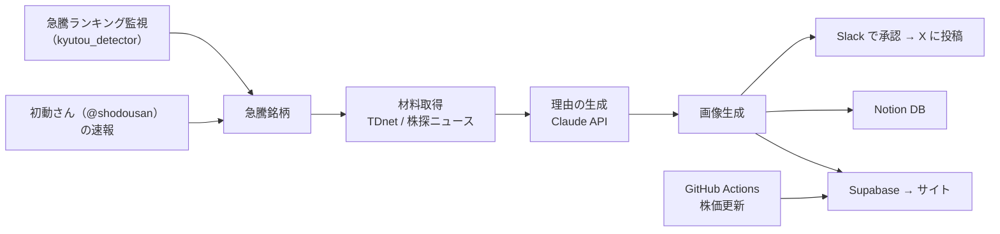
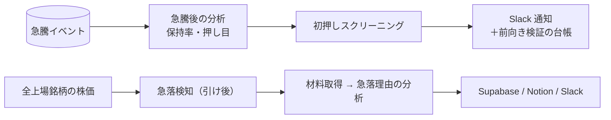

# stock-surge-tracker

日本株の急騰銘柄を検知し、その日の適時開示やニュースをもとに「なぜ上がったのか」を Claude API で要約して、サイトと X に自動で届けるシステムです。

運営中のサイト：**[株価急騰要因メモ（kyuutoumemo.com）](https://kyuutoumemo.com)**

## できること

- **急騰の検知**：2つのソースから急騰銘柄を拾います。
  - X アカウント「初動さん（@shodousan）」の速報ポスト（Playwright で取得）
  - Yahoo!ファイナンスの急騰ランキングを監視する自作の検知システム（`kyutou_detector`、別リポジトリ）
- **材料の取得**：その銘柄の当日の一次情報を集めます。
  - TDnet の適時開示タイトル
  - 株探の銘柄別ニュース見出し
  - 取得窓は「前営業日 15:00 〜 当日」。引け後の開示が翌日の急騰理由になるパターンを拾うためです。
- **理由の生成**：集めた材料を根拠として Claude API に渡し、急騰理由をテンプレートに沿って要約します。材料なしで推測させる方式と比べた精度評価も行いました（`eval_reason_accuracy.py`）。
- **画像の生成**：ローソク足チャート、銘柄情報、キーワードをまとめた 1200×630 の画像を作ります。
- **配信**：
  - Supabase に保存してサイトへ即時反映
  - Notion データベースに分析履歴を蓄積
  - Slack で投稿の承認（スマホから y/n）を取ってから X に投稿
- **株価の更新**：GitHub Actions で、検知済みの全銘柄（約840）の現在値を取得して Supabase を更新します。
- **急落の検知**：全上場銘柄から -10% 以上の急落を引け後に検知し、急騰側と同じ材料取得を流用して「なぜ落ちたか」を分析します。結果は Supabase・Notion に保存し、Slack に通知します。
- **押し目スクリーニング**：急騰した銘柄が初めて 25 日線まで押した日を検出し、条件を満たす銘柄とチャートを毎日引け後に Slack へ通知します。

## 全体の流れ





## 分析・研究用スクリプト

蓄積した急騰イベントのデータを使った分析です。

| スクリプト | 内容 |
| --- | --- |
| `surge_outcome_analysis.py` | 急騰から 5／20 営業日後に上昇分をどれだけ保っているか（保持率）を計算し、材料の種類・出来高・時価総額などで比較 |
| `dip_rebound_analysis.py` | 急騰後に初めて 25 日線まで押した銘柄が、反発するか突き抜けるかを比較 |
| `eval_reason_accuracy.py` | 理由生成で、材料を渡さない場合・TDnet を渡す場合・ニュースを渡す場合の 3 通りを比較評価 |
| `dip_filter.py` | 初押しの採用条件（テーマ・値幅・移動平均の乖離・下抜けの浅さ＋MACD／出来高）による判定。仕様は `dip_filter_spec.md` |
| `dip_outcome.py` | 押し目エントリーの成否の定義（翌営業日始値で入り、-8% で損切り、10 営業日後に判定）と、前向き検証用の台帳 |
| `reason_axes.py` | 急騰理由のテキストを、少数の水準を持つ複数の軸に分解して特徴量にする |
| `reason_model.py` | 急騰理由から押し目の成否を予測。ウォークフォワードで、その時点で結果が確定していたデータだけを学習に使う |
| `reason_llm.py` | 急騰の中身を LLM に通して読ませ、押し目の成否を判断させる（結果データを見せないので、全件を検証に使える） |
| `market_context.py` | 地合い（日経平均）と個別銘柄の相対的な強さ |
| `build_rebound_pdf.py` | 初押しで反発した銘柄を 1 銘柄 1 ページでまとめた学習用 PDF を作成 |

## 工夫した点

- **チャートの描画待ち**：Yahoo の株価データは約 20 分遅れるため、検知直後に画像を作ると急騰の陽線が写りません。検知から一定時間が経つまで処理を保留しています。
- **材料取得の失敗に強くする**：TDnet やニュースの取得に失敗しても警告を出して材料なしで続行し、パイプライン全体は止めません。
- **株価更新の高速化**：1 銘柄ずつ取得していた方式では全銘柄の更新に約 30 分かかっていました。`yf.download` のバッチ取得（80 銘柄ずつ）に変えて数分で終わるようにし、全銘柄を毎回更新できるようにしました。
- **過学習を避ける検証**：データを見ながら条件を何度も選び直すと、手元のデータに合わせただけの基準になってしまいます。そこで、判定条件と閾値を固定してバージョンを付け、その日に初めて観測した判定だけを台帳に記録して、後から成績を答え合わせする形にしています。
- **不具合からの設計変更**：急落検知をザラ場の監視ループで動かしていたところ、古い終値のキャッシュと比べてしまい、株式分割を -70% の急落と誤検知する不具合がありました。キャッシュを更新する経路を通る、引け後の日次バッチに移しています。
- **定期実行の安定化**：GitHub Actions 標準の schedule は発火が不安定なため、ザラ場中は外部スケジューラ（cron-job.org）から 15 分間隔で起動し、大引け後のみ schedule をバックアップにしています。

## 使用技術

Python ／ pandas ／ Claude API（Anthropic）／ Playwright ／ Supabase ／ Notion API ／ Slack ／ yfinance ／ mplfinance ／ GitHub Actions

## 主な使い方

```bash
pip install -r requirements.txt
playwright install chromium
cp .env.example .env   # API キーなどを設定

python main.py --setup          # X にログインして認証状態を保存
python main.py --watch 5 --slack  # 5 分間隔で監視し、Slack 承認後に X 投稿
python main.py --demo           # X に接続せずに動作確認
```

ローカル（Windows）では、タスクスケジューラで次の処理を自動実行しています。

- `setup_scheduler.ps1`：平日 9:00〜15:30 に急騰の監視を起動・停止
- `run_surge_analysis.bat`：引け後に急騰後の分析と押し目スクリーニングを実行し、Slack に通知
- `run_drop_analysis.bat`（`setup_scheduler_drop.ps1`）：引け後に急落を検知・分析
- `setup_scheduler_ohlc.ps1`：サイトのチャート用の株価（`sync_ohlc.py`）を同期

## ファイル構成

| ファイル | 役割 |
| --- | --- |
| `main.py` | 全体の実行（監視・分析・保存・投稿） |
| `fetcher.py` | 初動さんの速報ポストの取得 |
| `kyutou_source.py` | 自作の急騰検知システムとの接続 |
| `materials.py` | TDnet・ニュースの取得 |
| `analyzer.py` | Claude API による理由の生成 |
| `image_generator.py` | チャート画像の生成 |
| `site_sync.py` | Supabase への保存（サイト反映） |
| `notion_storage.py` / `storage.py` / `viewer.py` | Notion・ローカルへの保存と閲覧用 HTML |
| `slack_notifier.py` / `poster.py` | Slack での承認と X への投稿 |
| `update_stock_prices.py` | 株価の更新（GitHub Actions から実行） |
| `sync_ohlc.py` | サイトのチャート用の日足・週足を Supabase に保存 |
| `drop_detector.py` / `drop_analyzer.py` / `drop_notifier.py` / `notion_drop_storage.py` / `drop_chart.py` | 急落の検知・分析・通知・保存・チャート |
| `dip_rebound_analysis.py` / `dip_filter.py` / `dip_routes.py` / `dip_screener.py` / `dip_chart.py` / `notify_analysis_slack.py` | 押し目の分析・スクリーニング・Slack 通知 |
| `redo_stock.py` / `backfill_surge_prices.py` / `backfill_notion_to_supabase.py` | 特定銘柄の再分析や、過去データの補完 |
